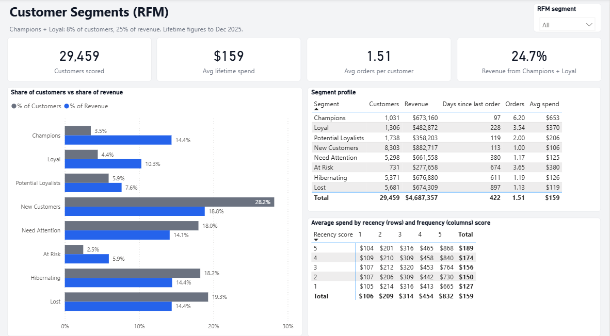
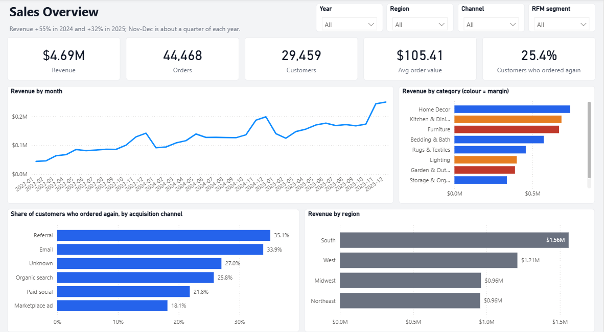
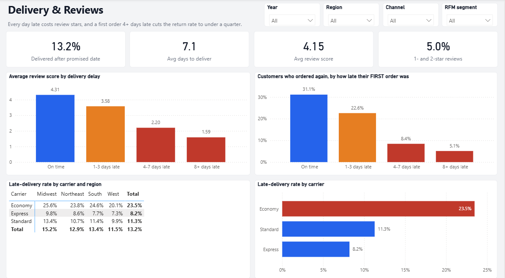
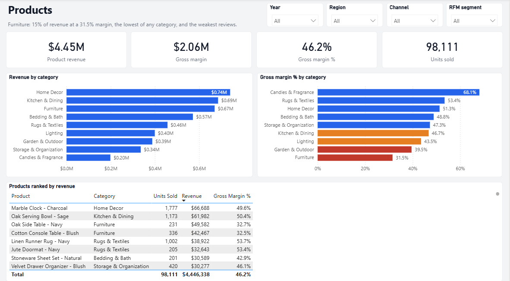
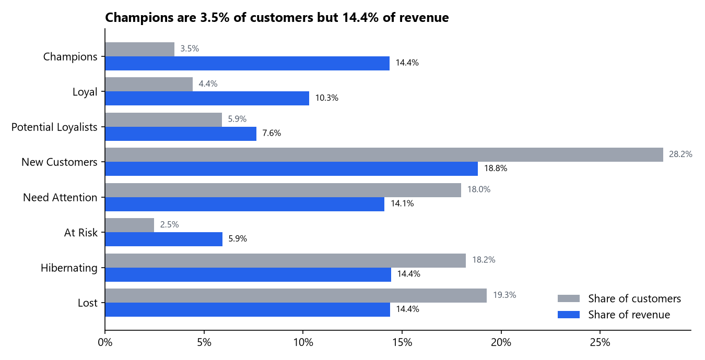
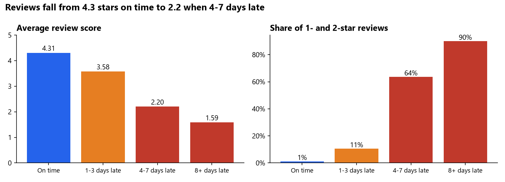
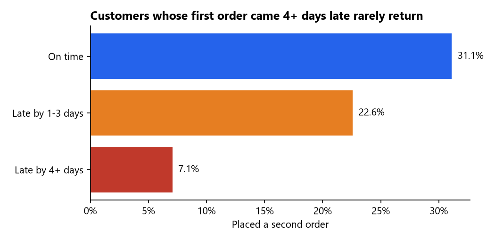
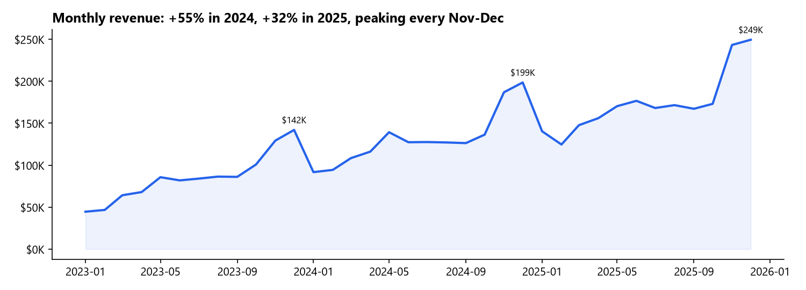
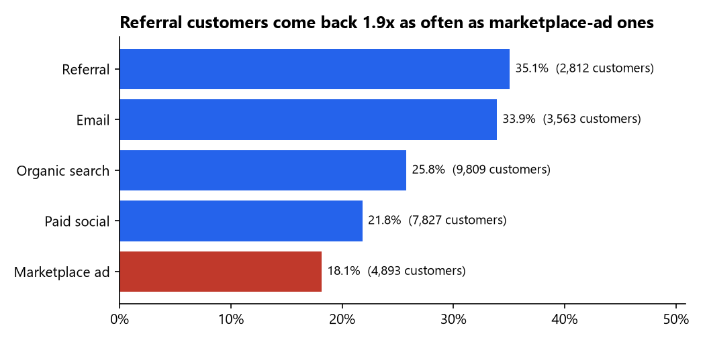
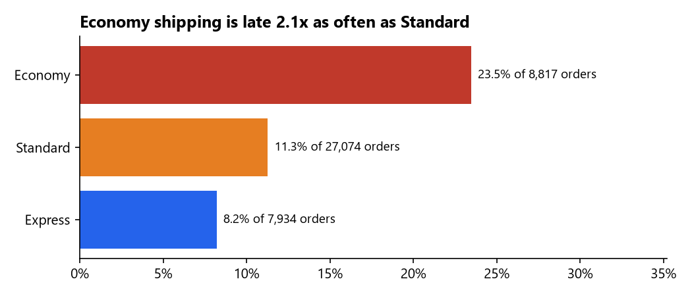

# E-commerce Customer Segmentation (RFM) & Delivery Analysis

**Python data generation & cleaning → SQLite + SQL → RFM segmentation → Jupyter EDA → Power BI dashboard**

Harbor & Pine is a (fictional) US online home & lifestyle store with three years of orders (2023 to 2025): 30,000 customers, 45,455 orders, $4.69M in revenue. Management asked two questions: **which customers bring repeat revenue, and what do late deliveries cost us?**

**Live summary page:** _see below once deployed_



> **About the data.** The dataset is **synthetic**: I wrote a generator ([`scripts/generate_data.py`](scripts/generate_data.py)) that simulates customers, orders, items, payments and reviews with realistic behaviour (growth, Nov–Dec peaks, loyal vs one-off buyers, carrier delays, reviews that drop when orders are late, customers who don't return after a bad experience). The raw export is deliberately messy so the cleaning step has real work to do. The effects are modelled in the generator, so the analysis shows the method on a known ground truth rather than discovering facts about a real company.

## Key findings

| | Finding | Why it matters |
|---|---|---|
| 1 | **Revenue grew 55% in 2024 and 32% in 2025** while average order value stayed flat at about $105. | Growth comes from more customers and orders, not bigger baskets. |
| 2 | **Only 25% of customers order a second time.** Of those who do, 60% come back within 90 days. | The first 90 days are the window for a re-order campaign. |
| 3 | **Champions and Loyal customers are 7.9% of customers but 24.7% of revenue** (avg lifetime spend $653 for Champions vs $106 for a one-order new customer). | Losing a few hundred top customers costs as much as thousands of one-off buyers. |
| 4 | **731 "At Risk" customers** (3.6 orders on average, nothing for 22 months) hold $278K of past revenue. | The highest-value win-back list. |
| 5 | **Every day late costs review stars:** 4.31 on time, 3.58 when 1–3 days late, 2.20 at 4–7 days, 1.59 at 8+ days. 64% of 4–7-day-late orders get 1 or 2 stars. | Lateness, not product, drives bad reviews. |
| 6 | **A late first order loses the customer:** 31.1% order again after an on-time first delivery, 22.6% after 1–3 days late, 7.1% after 4+ days late. | A late first delivery cuts the chance of a repeat customer by more than three-quarters. |
| 7 | **Economy shipping is late 23.5% of the time vs 11.3% for Standard**, worst in the Midwest (25.6%). | Carrier choice is the main lever on lateness. |
| 8 | **Referral (35%) and email (34%) customers come back almost twice as often as marketplace-ad customers (18%).** | Acquisition spend should be judged on repeat value, not first-order cost. |
| 9 | **Furniture is 15% of revenue at a 31.5% gross margin** (store average 46%) and has the lowest review score (3.97). | Damage-prone, low-margin category to review. |

## Recommendations
1. **Stop defaulting first orders to Economy shipping.** Upgrading first-time customers to Standard targets the group where lateness costs the most (finding 6).
2. **Run a 30–90-day re-order campaign** for new customers, the window where 60% of repeat orders happen.
3. **Win back the At Risk segment** with a personal offer before they become Lost; they have the best track record of any inactive group.
4. **Shift acquisition budget toward referral and email**, measured on 12-month customer value rather than cost per first order.
5. **Review Furniture pricing and packaging**: lowest margin and lowest reviews.
6. **Send finance the 40 orders where payments don't add up** (query 11 in [`sql/results.md`](sql/results.md)).

## Power BI dashboard

Four pages, with Year, Region, Channel and RFM-segment slicers synced across pages. Colours come from DAX measures (red / orange / blue thresholds for review score, late rate, return rate and margin).

| Sales Overview | Delivery & Reviews |
|---|---|
|  |  |



Saved as a **Power BI Project** ([`powerbi/HarborPine.pbip`](powerbi/HarborPine.pbip)): model in TMDL, report in PBIR JSON, generated by [`scripts/build_pbip.py`](scripts/build_pbip.py). The model has two fact tables (orders, order items) sharing customer, product, date and RFM dimensions, and 33 measures. Measure totals were checked against the SQL output (revenue $4,687,356.64, 44,468 orders, 29,459 customers).

## SQL (SQLite)

[`sql/analysis.sql`](sql/analysis.sql) answers 11 business questions with CTEs, joins and window functions (`LAG`, `NTILE`, `ROW_NUMBER`, `SUM() OVER`). [`scripts/run_sql.py`](scripts/run_sql.py) runs them and writes every result to [`sql/results.md`](sql/results.md).

**RFM scoring** (query 05): Recency and Monetary are quintiles (`NTILE(5)`); Frequency uses order-count bands (1, 2, 3, 4–5, 6+) because 75% of customers have one order and quintiles would split identical customers at random. Segments: Champions, Loyal, Potential Loyalists, New Customers, Need Attention, At Risk, Hibernating, Lost.

| Segment | Customers | % customers | % revenue | Avg orders | Avg spend |
|---|---:|---:|---:|---:|---:|
| Champions | 1,031 | 3.5% | 14.4% | 6.20 | $653 |
| Loyal | 1,306 | 4.4% | 10.3% | 3.54 | $370 |
| Potential Loyalists | 1,738 | 5.9% | 7.6% | 2.00 | $206 |
| New Customers | 8,303 | 28.2% | 18.8% | 1.00 | $106 |
| Need Attention | 5,298 | 18.0% | 14.1% | 1.17 | $125 |
| At Risk | 731 | 2.5% | 5.9% | 3.65 | $380 |
| Hibernating | 5,371 | 18.2% | 14.4% | 1.19 | $126 |
| Lost | 5,681 | 19.3% | 14.4% | 1.13 | $119 |

## Python charts

From [`scripts/make_charts.py`](scripts/make_charts.py) (matplotlib). The full exploration, with more charts, is in [`notebooks/01_exploration.ipynb`](notebooks/01_exploration.ipynb).













## Data cleaning (Python, pandas)

[`scripts/clean_and_load.py`](scripts/clean_and_load.py) runs every check below and writes them to `data_clean/data_quality_log.csv`.

| Check | Rows | Action |
|---|---:|---|
| State given as full name or lower case ("California", "ca") | 2,647 | Standardised to 2-letter code, region added |
| City with extra spaces or wrong case ("  BOSTON ") | 1,490 | Trimmed, title-cased |
| Missing acquisition channel | 565 | Set to "Unknown" |
| Product category in wrong case | 19 | Mapped to the 9 standard names |
| Missing product weight | 14 | Category median |
| Duplicated order-item rows in the export | 283 | Dropped |
| Duplicated review rows | 120 | Dropped |
| Payments that don't add up to the order total | 40 | Kept, flagged `payment_mismatch` |
| Order total ≠ items + shipping, delivered before purchase, unknown products | 0 | Checked |
| Canceled orders / still in transit at year end | 987 / 643 | Kept; canceled excluded from revenue and RFM |

## Data model

```
              dim_date        dim_product
                 │                 │
dim_customer ── fact_orders    fact_order_items ── dim_customer
                 │                 │
             customer_rfm      customer_rfm
```
- **fact_orders** (45,455): one row per order with totals, carrier, delivery days, delay, review score, repeat flags
- **fact_order_items** (70,816): one row per product line with revenue, cost and margin
- **dim_customer** (30,000), **dim_product** (827), **dim_date** (2023–2025), **customer_rfm** (29,459 scored customers)

## How to run
```bash
pip install pandas numpy matplotlib seaborn tabulate
python scripts/generate_data.py    # synthetic raw data -> data_raw/   (about 3 minutes)
python scripts/clean_and_load.py   # cleaning + SQLite + star schema -> data_clean/
python scripts/run_sql.py          # 11 SQL questions -> sql/results.md, RFM -> data_clean/customer_rfm.csv
python scripts/make_charts.py      # README charts -> images/
python scripts/build_pbip.py       # Power BI project -> powerbi/HarborPine.pbip
```
Open `powerbi/HarborPine.pbip` in Power BI Desktop (November 2025 release or later) and click **Refresh**. The CSV folder is the `DataFolder` parameter (Transform data → Edit parameters). The generator is seeded, so every run produces the same data.

## Tools
Python (pandas, NumPy, matplotlib, seaborn) · SQL (SQLite: CTEs, window functions) · Jupyter · Power BI (DAX, Power Query, PBIP/TMDL) · data modelling · RFM segmentation
